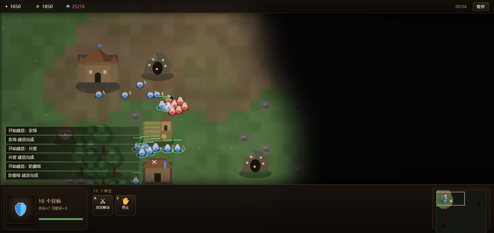

# 王国争霸 · 浏览器即时战略（受经典 RTS 启发）

在线试玩：**https://master-640.github.io/kingdom-rts/**

纯 HTML5 Canvas + 原生 JavaScript 实现的 2D 即时战略游戏，无需构建、无外部依赖。
资源采集、造建筑、造兵、人口、迷雾、寻路、敌方 AI 波次进攻，能完整打一局分胜负。



## 运行

直接双击 `index.html` 即可（Chrome / Edge / Firefox 均可，file:// 直接打开）。

如果想用本地服务器：

```bash
python -m http.server 8000
# 打开 http://127.0.0.1:8000
```

## 部署到 GitHub Pages

本项目是纯静态站点，没有构建步骤，所有资源都用相对路径，放在仓库子路径下也能直接跑。

1. 新建**公开**仓库，把本目录内容放到仓库根目录（`index.html` 必须在根）。
2. 仓库 Settings → Pages → Source 选 `Deploy from a branch`，分支 `main`，目录 `/ (root)`。
3. 等约 1 分钟，访问 `https://<你的用户名>.github.io/<仓库名>/`。

仓库里已带 `.nojekyll`，会跳过 Jekyll 处理；无需任何 CI 配置。

## 操作

| 操作 | 说明 |
| --- | --- |
| 左键单击 | 选择单位 / 建筑 / 资源 |
| 左键拖拽 | 框选单位 |
| 左键双击 | 选中屏幕内同类单位 |
| 右键 | 移动 / 攻击敌人 / 采集资源 / 设置集结点 |
| `A` + 左键 | 攻击移动（途中自动交战） |
| `S` | 停止 |
| `B` → `Q/W/E` | 农民建造：农场 / 兵营 / 防御塔 |
| `Q/W/E` | 训练：农民、步兵、弓手、骑士 |
| `Esc` | 取消建造 / 攻击移动 / 选择 |
| 空格 | 视角回到主基地 |
| 方向键 / 鼠标贴边 | 移动视角 |
| 滚轮 | 缩放 |
| 中键拖拽 | 拖动视角 |
| 小地图左键 / 右键 | 跳转视角 / 对目标点下令 |
| `P` | 暂停 |

## 玩法要点

- 5 名农民 + 2 名步兵开局，目标是摧毁敌方（黯影军团）的城镇大厅。
- 右键金矿或树木让农民采集；主力经济是金币，木材用来造建筑和远程兵。
- 人口上限：城镇大厅 12，每座农场 +6。人口满了就造农场。
- 兵营出兵：步兵（近战肉盾）、弓箭手（远程）、骑士（重装高伤）。
- 防御塔会自动攻击射程内敌人，适合守基地和金矿。
- 敌方 AI 会在约 2 分钟后开始成波进攻，波次规模随时间增长。
- 部队全灭也没关系，只要城镇大厅还在就能翻盘；反之亦然。

## 技术实现

| 模块 | 文件 | 说明 |
| --- | --- | --- |
| 配置数值 | `js/config.js` | 单位 / 建筑 / 资源全部数值表 |
| 通用工具 | `js/util.js` | 数学、可复现随机数、A* 用的最小堆 |
| 世界 | `js/world.js` | 中心对称地形生成、格子阻挡、多目标 A* 寻路、连通性检查 |
| 实体 | `js/entities.js` | 单位状态机（移动/攻击/采集/建造）、建筑训练队列、投射物 |
| 游戏逻辑 | `js/game.js` | 命令、编队、战斗结算、经济、人口、视野迷雾、胜负判定 |
| AI | `js/ai.js` | 农民分配、农场/兵营/防御塔建造、练兵、成波进攻 |
| 渲染 | `js/render.js` | 地形预渲染 + 模糊融合、树精灵、建筑绘制、迷雾、小地图 |
| 界面 | `js/ui.js` | 资源栏、选择面板、命令卡、提示、结算 |
| 输入 | `js/input.js` | 框选、右键上下文命令、建造放置、镜头控制 |
| 启动 | `js/main.js` | 装配与主循环 |

## 测试

`test/` 下是开发期用的无头测试（需要 Node 18+，不参与游戏运行）：

```bash
node test/sim-test.js    # 完整对局模拟：AI vs 脚本玩家，检查稳定性与平衡
node test/diag.js        # 采集速率 / 战斗结算 / 建造流程 数值诊断
```

`test/cdp.js`、`test/play.js` 通过 Chrome DevTools Protocol 自动点击游戏，用于验证交互链路。
